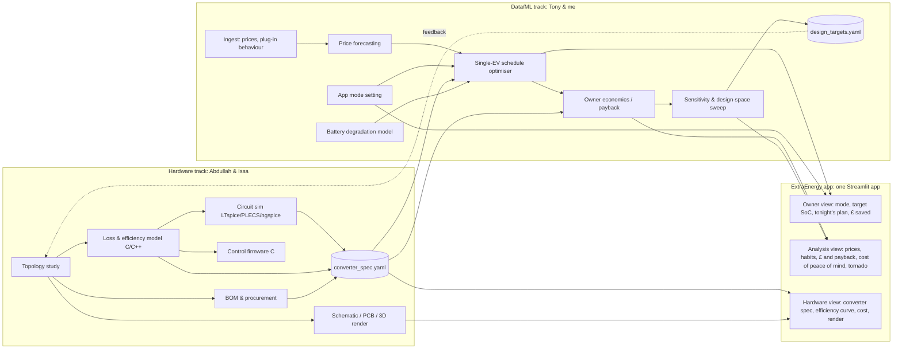

# V2G Hackathon — Project Context File

> **Purpose of this file:** a single source of truth to feed an LLM (or the team) to generate the repo skeleton, pipeline stubs, interfaces and task split. It is deliberately **open-ended on deliverables** (a menu, not a fixed scope), but **strict on interfaces, units and the logical chain**, so that whatever subset gets built still fits together.
>
> **Status:** brainstorm v0.4 (v0.2 added app optimisation modes, §8.B.1; v0.3 adds the app plan, §8.I; v0.4 narrows the scope to a **single vehicle**: fleet aggregation, EV adoption and national grid impact are out of scope (roadmap: "ExtraEnergy for fleets"), and the app has three views: owner, analysis, hardware). Items marked `ASSUMPTION` are guesses. Items marked `OPEN` need a team decision. Items marked `PLACEHOLDER` are numbers to be replaced by real outputs.

---

## 0. How to use this file (instructions for a skeleton generator)

1. Generate the repo tree in **§10**, with one stub module per pipeline stage in **§9**.
2. Every stage reads and writes only the artefacts named in §9. No hidden coupling.
3. Implement the **shared interface schema in §6 first**, as Pydantic models plus YAML. Everything downstream imports it.
4. All physical quantities use the units in **§6.3**. Convert at ingest, never mid-pipeline.
5. Every stage must run end-to-end on **placeholder/default inputs from hour 0**. Real data and real hardware numbers replace the defaults later, without code changes.
6. Generate tests for the consistency checks in **§12**.

---

## 1. One-line pitch and the core thesis

**Pitch:** *We sell a complete V2G product: a bidirectional EV charger (hardware) plus the software that runs it, which learns from each driver's usage and forecasts energy prices to decide when the car should charge and when it should sell back. The owner chooses how the software behaves: maximum savings, or the best savings while guaranteeing the car is charged to a level they pick whenever they need it. We show, with data, what that combined product is worth to the owner, and how much energy each car sells back to the grid when it is needed most.*

**Brand:** **ExtraEnergy** — *"Making energy work for you."* Green brand. Target market: any EV owner with a home mains connection, supported by government subsidies. Mission line: *Accelerating the EV transition.* (Source: `app_ideas.md`.)

**Scope:** one vehicle and one home charger. **Roadmap, not built:** ExtraEnergy for fleets (many vehicles from one app); the owner view shows it as "coming soon".

**The logical chain.** Every deliverable should hang off one of these links:

```
[Hardware design]  →  converter spec (kW, efficiency curve, cost, response time)
        ↓
[Single vehicle]   →  optimal buy/sell schedule (per app mode)  →  £/yr per owner, battery wear
        ↓
[Owner economics]  →  payback of the bidirectional premium, kWh sold back at peak
        ↓
[Feedback]         →  "which converter rating / efficiency / cost maximises value?"
                       → back to the hardware team (the co-design loop)
```

**The headline sentence the demo should end on (template):**
> "Our **{P_rated} kW**, **{η_peak}%**-efficient charger, costing **{cost}**, run by our scheduling software, which learns each driver's habits and forecasts prices, earns an owner **{£/yr}**. That is **{uplift}%** more than a simple cheapest-hours timer. The system pays back in **{years}**, and each car sells **{kWh/yr}** back to the grid when it is needed most."

Every `{}` comes from a pipeline artefact. This sentence *is* the integration test.

The numbers come from these artefacts:
- `{uplift}` comes from S5 (§8.B). It is `revenue_learned / revenue_rule_based − 1`.
  - `revenue_learned` is the forecast-driven MPC schedule, using learned availability.
  - `revenue_rule_based` is ladder step 1 (cheapest-hours timer), on the same vehicles and price period.
  - Both are stored in `revenue_per_vehicle.json`.
  - `OPEN`: raw revenue is negative because the owner still pays for driving energy, so the ratio breaks. Proposal: use **savings vs an unmanaged charger** for both terms. (The starter app in §8.I already does this: savings = unmanaged cost − managed cost, with both ending at the same SoC.)
- `{£/yr}` uses the learned-software revenue, so the hardware and software claims share one number. `OPEN`: quote it for which app mode? Suggestion: quote "guaranteed charge" mode at a default target, and show "max savings" alongside.

---

## 2. Team, strengths and ownership

| Person | Strengths | Primary track | Natural bridge role |
|---|---|---|---|
| **Abdullah** | Electrical hardware, transistor/device-level design, **C++** | Hardware | C++ averaged/loss model of the converter → exports the efficiency table (§6) |
| **Issa** | Electrical hardware, **C** | Hardware | Embedded-style C control loop (DAB phase-shift / PI), or a C loss calculator |
| **Tony** | Advanced Python, ML modelling, optimisation | Data/ML | Owns optimisation (§8.B) and forecasting (§8.A) |
| **Me** (generalist) | Python, modelling, ML | Data/ML + integration | Owns the schema, pipeline glue, the habits model (§8.B Option B), **the app (§8.I)** and pitch |

**Working principle:** the two halves stay mostly independent and meet at **one contract**: `config/converter_spec.yaml` (§6). The hardware team owns it. The data team consumes it, and returns `design_targets.yaml` (§6.4).

`OPEN`: who owns the final demo/pitch? Suggestion: the generalist, with one slide from each track.

---

## 3. Assumptions and open questions (resolve in the first 30 minutes)

| # | Question | Default if unresolved |
|---|---|---|
| Q1 | Hackathon length? | `ASSUMPTION` 24–36 h. The milestone plan in §13 is in relative hours. |
| Q2 | Judging criteria (technical depth / impact / demo / feasibility)? | Optimise for **a working demo + one clear number + a credible chain** |
| Q3 | Region for grid and price data? | Parameterised as `region` in `config/assumptions.yaml`. Candidate regions: GB, a European bidding zone, a US ISO (§11). |
| Q4 | AC or DC V2G architecture? | Present both in a trade-off table. Pick **DC off-board (wallbox)** as the primary design, since it's the cleanest power-electronics story. |
| Q5 | Home charger (single-phase ~7 kW) or 3-phase/depot (11–22 kW+)? | Home single-phase primary. The sensitivity sweep covers the rest. |
| Q6 | Is any physical hardware allowed or available? | `ASSUMPTION` no high-voltage hardware. A **low-voltage** demo only (§7.3, H8). |
| Q7 | Sponsor tools or APIs to use? | None assumed |
| Q8 | Currency | Set in config. Prices are stored internally as currency/MWh. |
| Q9 | Public repo allowed? (needed for the simplest free deploy, §8.I) | `ASSUMPTION` yes. If not, deploy from a private repo or demo locally only. |

---

## 4. Landscape snapshot (for the "why now" slide). Verify before quoting.

- **Commercial V2G is arriving in 2026:**
  - BMW and E.ON have offered a wallbox, V2G tariff and smart-meter bundle in Germany since February 2026.
  - Volkswagen/Elli plan a German V2G offer for Q4 2026.
  - Ford reportedly planned a V2G tariff with Octopus Energy in the UK from summer 2026.
  - Nissan announced an AC bidirectional (on-board charger) system for 2026, aimed at a price close to a normal charger.
- **Regulation matters to the economics.** Germany removed "double grid fees" on stored-and-re-exported energy, which made V2G viable there. This is a great example of a **policy parameter** to include in the economics model.
- **Grid planners expect EVs to be the biggest flexibility resource.** One analysis of Britain's system operator's scenarios cites roughly 30–36 M EVs by 2050, with EVs as the largest flexibility source (tens of GW).
- **Standards:**
  - ISO 15118-20 (bidirectional communication)
  - IEC 61851 (conductive charging)
  - CHAdeMO (the historical DC V2G route)
  - Grid-connection rules by region: e.g. G98/G99 in GB, IEEE 1547 / UL 1741 in the US.

**Narrative hook:** the hardware exists and tariffs are launching. *The open question is how much value a specific converter design unlocks.* That is our project.

---

## 5. System architecture



---

## 6. THE interface contract (build this first)

### 6.1 `config/converter_spec.yaml`: produced by Hardware, consumed by Data

```yaml
spec_version: "0.1"
provenance: placeholder        # placeholder | hand_calc | simulation | datasheet | measured
topology: "DAB (dual active bridge) DC-DC + totem-pole bidirectional AC-DC"   # PLACEHOLDER
architecture: dc_offboard       # dc_offboard | ac_onboard
grid_side:
  phases: 1
  v_ac_rms: 230                 # V
  f_hz: 50
battery_side:
  v_dc_min: 250                 # V
  v_dc_max: 450                 # V   (800 V platforms → second variant)
power:
  p_charge_max_kw: 7.4          # PLACEHOLDER (single-phase 32 A)
  p_discharge_max_kw: 7.4       # PLACEHOLDER (may be lower than charge)
  q_max_kvar: 3.0               # reactive power capability (voltage support)
efficiency_curve:               # grid-to-battery and battery-to-grid, vs fraction of rated power
  load_fraction:   [0.05, 0.10, 0.25, 0.50, 0.75, 1.00]
  eta_charge:      [0.80, 0.88, 0.94, 0.96, 0.96, 0.955]   # PLACEHOLDER
  eta_discharge:   [0.78, 0.87, 0.93, 0.955, 0.955, 0.95]  # PLACEHOLDER
standby_w: 10                   # idle loss while plugged in (matters for low-value hours!)
dynamics:
  response_time_s: 1.0          # setpoint → 90% power; gates eligibility for frequency services
  ramp_kw_per_s: 5.0
cost:
  bom_cost: 900                 # PLACEHOLDER, from BOM in hardware/bom/bom.csv
  install_cost: 500             # ASSUMPTION
  unidirectional_baseline_cost: 800   # cost of a normal charger → premium = (bom+install) − baseline
lifetime_years: 10
uncertainty:                    # ± bands used in the sensitivity analysis
  eta_abs: 0.01
  cost_rel: 0.25
```

### 6.2 Rules for the contract

- The hardware team may **change values but not field names or units** without bumping `spec_version`.
- The data side derives everything from this file. Nobody hard-codes "7 kW" or "95%" anywhere else. **The app reads this file too**; its built-in defaults are only a fallback when the file is missing.
- `provenance` is shown on the dashboard, so judges can see which numbers are calculated and which are assumed. That honesty is a credibility point.
- Placeholders are realistic from hour 0, so **the data team is never blocked**.

### 6.3 Units and conventions (global)

| Quantity | Unit | Note |
|---|---|---|
| Power | kW | Sign convention: **+ = grid → vehicle (charging)**, **− = vehicle → grid** |
| Energy | kWh | |
| Price | currency/MWh internally | 1 p/kWh = 10 £/MWh. Convert at ingest only. (The owner view displays p/kWh, converted in one display helper.) |
| Time | UTC timestamps internally, local time only for display | Watch **DST change days**: e.g. a GB clock-change day has 46 or 50 half-hour settlement periods, not 48 |
| Resolution | 30 min default (`dt_h = 0.5`) | Configurable. Must match the price data's settlement period. |
| SoC | fraction 0–1 | |
| Efficiency | fraction 0–1 | Always < 1. Round-trip = η_ch · η_dis · η_batt_rt |

### 6.4 `config/design_targets.yaml`: produced by Data, consumed by Hardware (feedback loop)

```yaml
# Output of the sensitivity/design-space sweep (§8.H)
value_optimal_p_rated_kw: null      # rating beyond which extra kW adds little £
marginal_value_per_eta_point: null  # currency/yr per +1% efficiency → is better silicon worth it?
max_cost_for_5yr_payback: null      # cost ceiling the BOM must hit
min_response_time_for_freq_services_s: null
```

This closes the loop: hardware decisions become **data-driven**, and data results become **hardware-grounded**.

---

## 7. Hardware track: options and tiers (Abdullah & Issa)

### 7.1 Topology options (deliverable: a trade-off table)

| Stage | Options | Notes / why |
|---|---|---|
| AC ↔ DC (grid side) | **Totem-pole bridgeless PFC (bidirectional)**, full-bridge inverter/rectifier, 3-phase 2-level/Vienna (Vienna is unidirectional, so note that as a pitfall) | Totem-pole + SiC/GaN is the modern high-efficiency choice |
| DC ↔ DC (isolated) | **Dual Active Bridge (DAB)**, **CLLC resonant**, bidirectional LLC variants | DAB: simple phase-shift control, soft switching, classic. CLLC: higher efficiency at the resonant point, harder control across wide battery voltage. |
| Non-isolated (low-cost demo) | Bidirectional buck-boost / synchronous buck | Ideal for a **safe low-voltage demonstrator** |
| Devices | Si IGBT vs **SiC MOSFET** vs GaN HEMT | Device choice changes switching loss, so efficiency changes, so revenue changes. This is a **direct link to the data track**. |
| Architecture | **DC off-board** wallbox vs **AC on-board** (vehicle's OBC becomes bidirectional) | Trade-off: wallbox cost vs vehicle cost vs grid-code certification location |

### 7.2 Calculations that produce the spec numbers

1. **Ratings:** grid current = P / V. Device voltage and current stress with margin, typically 1.5–2× voltage derating.
2. **Loss breakdown at several load points** (this generates `efficiency_curve`):
   - conduction: I_rms² · R_ds(on)(T)
   - switching: ½ · V · I · (t_r + t_f) · f_sw, or E_on/E_off from datasheets; ≈ 0 for ZVS ranges
   - magnetics: core (Steinmetz: P = k · f^α · B^β · Vol) + copper
   - fixed/auxiliary: gate drive, control, fans → `standby_w`
3. **DAB power transfer:** P = (n · V1 · V2 · φ · (π − |φ|)) / (2π² · f_sw · L), with φ the phase shift. This gives the leakage-inductance design and the ZVS range check.
4. **Thermal:** T_j = T_amb + P_loss · R_th(j-a). The heatsink size feeds the BOM cost.
5. **Response time / control bandwidth** → `dynamics`. These decide whether the unit qualifies for fast frequency services.

### 7.3 Deliverable tiers (pick any; each one upgrades `provenance`)

| Tier | Deliverable | Tools | Feeds spec field |
|---|---|---|---|
| H0 | Block diagram + topology trade-off table | Markdown, draw.io, Python `schemdraw` | `topology`, `architecture` |
| H1 | Hand calcs / spreadsheet loss model → efficiency curve | Python or **C/C++ calculator** | `efficiency_curve`, `standby_w` |
| H2 | **C++ averaged / loss model** that sweeps load and V_batt and exports a CSV efficiency map | C++ (optional pybind11 so Python can call it during the design sweep) | `efficiency_curve` (2-D: P × V) |
| H3 | Circuit simulation with waveforms (ZVS, ripple, phase-shift control) | LTspice, ngspice/PySpice, PLECS (if licensed), Simulink | validates H1/H2 |
| H4 | **Closed-loop control in C**: PI current/voltage loop, phase-shift modulator, charge/discharge mode switch. Runs against the averaged model, or on a dev board. | C, for MCU targets like TI C2000 / STM32 | `dynamics` |
| H5 | **BOM with real part numbers + cost** (SiC MOSFETs, gate drivers, magnetics cores, caps, MCU, contactors, enclosure) | Distributor catalogues; `bom.csv` | `cost.bom_cost` |
| H6 | Schematic + PCB layout + **3D render** of the board/enclosure | **KiCad** (schematic → PCB → 3D viewer render), FreeCAD/Fusion/Blender for the enclosure | demo visuals (shown in the analysis view) |
| H7 | Standards & safety checklist (isolation, anti-islanding, RCD/DC fault detection, ISO 15118-20 comms, grid code) | Markdown | credibility |
| H8 | **Low-voltage physical demo** (e.g. 12 V ↔ 24 V bidirectional buck-boost showing power-flow reversal on command) | Dev board + MOSFETs + INA current sensor | "it works" moment |

> ⚠️ **Safety:** no mains or high-voltage DC builds at the hackathon. Simulate the high-power design and demo only the low-voltage analogue.

---

## 8. Data / ML / optimisation track: modules (Tony & me)

Each module lists: **question → method ladder (baseline → stretch) → inputs → outputs → key papers**.

### 8.A Price forecasting: *"What will electricity cost in each period tomorrow?"*
- **Ladder:**
  1. seasonal naive (same hour last week)
  2. LEAR (lasso-estimated autoregressive), the standard benchmark
  3. gradient boosting (LightGBM) with calendar, load, wind/solar forecast features
  4. deep models: N-BEATS, TFT, PatchTST
  5. zero-shot foundation models: Chronos, TimesFM
- **Make it probabilistic:** quantile outputs (P10/P50/P90) for robust scheduling. Score with pinball loss / CRPS.
- **Metric alignment (important):** besides MAE, report **decision value**: the revenue of a schedule built on the forecast vs a schedule built on perfect foresight (regret). A slightly worse MAE can give better money.
- **Leakage guard:** only use features known at decision time (e.g. before the day-ahead auction closes). Strict temporal train/val/test split.
- Inputs: `data/processed/prices.parquet`, `features.parquet` → Output: `artefacts/forecasts/price_quantiles.parquet`
- Papers: Weron 2014; Lago et al. 2021 (+ `epftoolbox`); Oreshkin et al. 2020 (N-BEATS); Lim et al. 2021 (TFT); Nie et al. 2023 (PatchTST); Ansari et al. 2024 (Chronos); Das et al. 2024 (TimesFM); Gneiting & Raftery 2007 (scoring).

### 8.B Single-vehicle schedule optimiser: *"When should this car buy, and when should it sell?"*
- **Core LP** (per vehicle, horizon T, step Δt):
  - maximise Σ_t [ p_t^sell · P^dis_t − p_t^buy · P^ch_t ] · Δt − c_deg · Σ_t (P^ch_t + P^dis_t) · Δt − standby cost
  - subject to:
    - SoC_{t+1} = SoC_t + ( η_ch · P^ch_t − P^dis_t / η_dis ) · Δt / E_cap
    - SoC_min ≤ SoC_t ≤ SoC_max (e.g. 0.2–0.9)
    - SoC at departure ≥ SoC_required (**the driver's needs always come first**). The form of this constraint is set by the app mode (§8.B.1).
    - 0 ≤ P^ch_t ≤ a_t · P_charge_max and 0 ≤ P^dis_t ≤ a_t · P_discharge_max (a_t ∈ {0,1} = plugged in)
- **Consistency details:**
  - η depends on power (from the spec curve). Use a piecewise-linear approximation, or fix η at the expected operating point and state it.
  - With **negative prices**, an LP can "cheat" by charging and discharging at the same time to burn energy through losses. Add a binary (MILP) or a complementarity constraint when negative prices exist in the data.
  - p^sell may differ from p^buy (export tariff ≠ import tariff, network fees, the "double fee" policy case). Keep them as separate series.
- **Ladder:**
  1. rule-based (charge cheapest k hours, discharge most expensive k)
  2. deterministic LP with forecast prices
  3. **MPC / rolling horizon** (re-optimise every period)
  4. stochastic or robust LP over forecast quantiles
  5. RL agent (PPO/SAC) as a comparison, e.g. in EV2Gym
- **Tools:** cvxpy, Pyomo or PuLP with HiGHS/CBC (free solvers). (The starter app uses `scipy.optimize.linprog` with HiGHS, which needs no extra install on Streamlit Cloud.)
- **Inputs:** spec, price forecasts, availability profile, degradation cost, **app mode + user target** → **Outputs:** `schedule.parquet`, `revenue_per_vehicle.json` (one entry per mode)
- **Papers:** Kempton & Tomić 2005 (×2, the V2G fundamentals and revenue maths); Sortomme & El-Sharkawi 2011/2012 (optimal V2G scheduling + ancillary services); Orfanoudakis et al. 2024 (EV2Gym simulator/benchmark).

### 8.B.1 App optimisation modes (user setting)
**Idea:** the app has a setting where the owner picks how the software behaves. In the background we keep several optimisation model variants and switch between them depending on the user's settings.

| Mode | User picks | What changes in the optimiser |
|---|---|---|
| **Max savings** | nothing | Only a safety floor: enough SoC for the next (learned/declared) trip plus a reserve. Maximum freedom, so maximum £. |
| **Savings + guaranteed charge** | a target SoC % (e.g. 80%) | Hard constraint: SoC ≥ target whenever the car is needed. Less freedom, so slightly less £, but zero range anxiety. |

- **Same objective, different constraint set.** Implement as a registry: `mode → (constraint builder, solver settings)`. The core model is shared; the mode only switches which constraint blocks are active.
- `OPEN`: what does "whenever they need it" mean?
  - (a) **ready by departure**: SoC ≥ target at each departure (declared in the app, or learned), or
  - (b) **always ready**: SoC ≥ target at every plugged-in moment, so V2G only ever uses energy above the target. This is robust to unpredictable trips and needs no departure prediction.
  - The starter app exposes both as a toggle so the team can feel the difference before deciding.
- `OPEN`: in max-savings mode, is the safety floor a hard constraint or a soft penalty? Suggestion: hard floor = next trip energy + reserve.
- **Demo number:** the £/yr gap between the two modes = **"the cost of peace of mind"**. A slider for the target % shows the trade-off live (target % vs £/yr).
- Config: `optimiser.mode` (`max_savings` | `guaranteed_charge`) and `optimiser.target_soc` in `assumptions.yaml`; per-user overrides later.

### 8.C Battery degradation: *"Does selling back wear the battery out?"*
- **Ladder:**
  1. linear cost per kWh throughput: c_deg = battery_cost / (cycle_life · 2 · E_cap · DoD)
  2. semi-empirical cycle + calendar ageing (Wang et al. 2011)
  3. rainflow cycle counting (Xu et al. 2018)
- **Talking point:** some work argues that smart V2G can *reduce* degradation by keeping SoC in gentler ranges (Uddin et al. 2017). Include it as a balanced counterpoint.
- Output: `c_deg` used in 8.B, plus a "battery health impact over 10 years" chart.

### 8.D–8.F Fleets, EV adoption and grid impact: out of scope (roadmap)
Removed in v0.4: we build for **one vehicle**. Fleet aggregation (many cars → GW of flexibility), the EV adoption forecast to 2036 and national grid-impact metrics (peak reduction, LOLE/ELCC) only matter once many cars are combined. They return with **ExtraEnergy for fleets**, shown in the owner view as "coming soon". (Plug-in behaviour for one car is learned by the habits model, §8.B Option B.) Section letters §8.G–I are kept so existing references still work.

### 8.G Owner economics: *"Is it worth buying?"*
- Annual net revenue = optimiser revenue − degradation − standby losses − any fees
- Payback = (spec cost − unidirectional baseline cost) / annual net revenue
- NPV at discount rate r over `lifetime_years`.
- Report per app mode (§8.B.1).
- Value stack options: arbitrage, V2H bill savings, frequency/capacity services (only if `response_time_s` qualifies), with policy toggles (export price, network fees).

### 8.H Sensitivity and design-space sweep: **the integration showpiece**
- Sweep spec parameters: P_rated ∈ {3.7, 7.4, 11, 22} kW, η shift ±2 pts, cost ±50%, plus price volatility and the user target SoC.
- Tornado chart (one-at-a-time) and Sobol indices (SALib) → "what matters most?"
- If the C++ model is exposed via pybind11, sweep **actual design parameters** (f_sw, device choice) → η curve → £. That is true hardware-ML co-design.
- Output: `design_targets.yaml` (§6.4) + charts.

### 8.I The app: ExtraEnergy (owner view + analysis view + hardware view)
**Decision:** one **Streamlit** app (`dashboard/app.py`), pure Python, no separate frontend. It runs **locally** from the cloned repo (`streamlit run dashboard/app.py` → opens at `http://localhost:8501`) and is **deployed to Streamlit Community Cloud** from the GitHub repo for a public link. No native phone app (Flutter / React Native): too much new learning for the time, and no extra judging value.

**How it works (for anyone new to apps):** Streamlit reruns the Python script from top to bottom every time a widget changes, and redraws the page. Widgets (`st.slider`, `st.radio`) return values; charts are Plotly figures passed to `st.plotly_chart`. Slow functions are wrapped in `@st.cache_data` so they only recompute when their inputs change.

**Three views in one app** (tabs at the top):

| View | Audience | Shows | Maps to |
|---|---|---|---|
| **Owner app** ("ExtraEnergy") | the customer; the "this is our product" moment | A phone-sized panel in green branding: **mode toggle** (max savings / guaranteed charge), **target-SoC slider**, "always ready" vs "ready by departure" toggle, departure time, **tonight's plan** chart (price, charge/sell bars, SoC line), **£ saved per year**, the **cost of peace of mind**, and a plain-English status line ("Selling to the grid 17:00–19:00, fully charged by 07:30") | §8.B, §8.B.1, D-b, D-c, D-m |
| **Analysis** | judges; the data/ML/optimisation proof (§8, Tony & me) | Hardware what-if sliders, the **§1 headline sentence filled in live**, owner savings (unmanaged vs smart charging vs V2G) and payback, prices (Tony's forecast, §8.A), the **cost of peace of mind** curve (§8.B.1), the **habits model** results (§8.B Option B), and the payback tornado (§8.H) | §1, §8.A–C, §8.G–H, I-a, I-b, I-d |
| **Hardware** | judges; the hardware track (Abdullah & Issa) | The converter spec with its `provenance` badge: ratings, efficiency-vs-load curve, grid/battery side, cost and V2G premium; later the KiCad render and the design targets sent back | §6.1, §7, I-c |

**Compute rule (keeps it fast):**
- **Precompute** anything heavy in the pipeline (forecasts, habits model, sensitivity sweeps) and save to `artefacts/`. The app only **reads** these files.
- **Compute live** only the single-car schedule (one small LP, solves in milliseconds), so the target-SoC slider updates the £ number as you drag.
- **Fallback:** if an artefact file is missing, the app uses built-in placeholder data and shows a "PLACEHOLDER" badge. The app must never crash because a pipeline stage hasn't run yet.

**Branding:** green theme in `.streamlit/config.toml` (one place to change colours). Name and tagline from §1.

**Deploying (Streamlit Community Cloud, free):** `ASSUMPTION` details to verify on the day.
1. Push the repo to GitHub with a `requirements.txt` at the root (the cloud reads this, not `pyproject.toml`).
2. Sign in to Streamlit Community Cloud with GitHub → "New app" → pick the repo, branch, and `dashboard/app.py`.
3. It builds and gives a public `*.streamlit.app` URL. Every push to the branch redeploys automatically.
4. **API keys** go in the cloud app's Secrets settings (read with `st.secrets`), never in the repo.
5. Free apps go to sleep when unused and take a short while to wake. **Open the link a few minutes before pitching.**
6. Put the link (and a QR code) on the final slide so judges can try it on their phones.

**Fallback order on stage:** public link → local `streamlit run` on the laptop → recorded demo video.

**Starter status:** a working `dashboard/app.py` exists (placeholder prices, spec read from `config/converter_spec.yaml` if present, live LP via SciPy/HiGHS, all three views). Replace the placeholder functions with artefact readers as each pipeline stage lands.

---

## 9. Pipeline: stages, inputs and outputs (each stage = one module + one CLI command)

| # | Stage | Owner | Inputs | Outputs |
|---|---|---|---|---|
| S0 | Config & schema | Generalist | — | `config/assumptions.yaml`, `config/converter_spec.yaml`, `shared/schema.py` |
| S1 | Hardware spec | Abdullah / Issa | calcs, sims, BOM | updated `converter_spec.yaml` (+ `efficiency_map.csv`) |
| S2 | Ingest & clean | Generalist | raw APIs/CSVs | `data/processed/{prices,sessions}.parquet` |
| S3 | Price forecast | Tony | prices, features | `artefacts/forecasts/price_quantiles.parquet` |
| S4 | Degradation | Tony / Generalist | battery params | `artefacts/degradation/c_deg.json` |
| S5 | Single-EV optimise | Tony | S1, S3, S4, availability, app mode | `artefacts/schedules/*.parquet`, `revenue_per_vehicle.json` |
| S9 | Economics | Tony | S1, S5 | `artefacts/econ/payback.json` |
| S10 | Sensitivity & targets | Tony | S1 (ranges), S5, S9 | `config/design_targets.yaml`, `artefacts/sensitivity/*` |
| S11 | App & headline | Generalist | everything (reads only; live LP for the owner view) | Streamlit app (owner, analysis and hardware views), local and public URL, headline sentence (§1) |

**Dependency order:** S0 → (S1 ∥ S2) → (S3, S4) → S5 → S9 → S10 → S11. (S6–S8, adoption, fleet and grid, were removed with the fleet scope.) Orchestrate with a `Makefile` (simplest) or Snakemake/DVC (stretch). S11 runs at every stage on placeholders, so it is never blocked.

---

## 10. Repo skeleton

```
v2g-hack/
├── README.md                     # pitch, how to run, headline result, public app link
├── CONTEXT.md                    # this file
├── app_ideas.md                  # branding notes
├── Makefile                      # make data | forecast | optimise | econ | sweep | app | all
├── pyproject.toml                # python deps (pandas, polars, cvxpy, highspy, lightgbm, torch?, salib, streamlit, pydantic)
├── requirements.txt              # minimal deps for Streamlit Cloud (streamlit, pandas, numpy, scipy, plotly, pyyaml)
├── .streamlit/
│   └── config.toml               # ExtraEnergy green theme
├── config/
│   ├── assumptions.yaml          # region, currency, dt_h, years, scenarios, battery params, app mode
│   ├── converter_spec.yaml       # §6.1 (hardware-owned)
│   └── design_targets.yaml       # §6.4 (data-owned)
├── shared/
│   ├── schema.py                 # Pydantic models for spec, assumptions, targets (validation on load)
│   └── units.py                  # conversions, sign convention, DST-safe time index helpers
├── docs/
│   └── optimisation_problem.md   # plain-language statement of the 8.B problem and app modes
├── hardware/
│   ├── docs/                     # topology trade-off, block diagram, standards checklist
│   ├── calc/                     # hand-calc loss model (python or C)
│   ├── model_cpp/                # C++ averaged + loss model → efficiency_map.csv (CMake; optional pybind11)
│   ├── firmware_c/               # control loop (PI, phase-shift modulator, mode state machine) + host test harness
│   ├── sim/                      # ltspice/ ngspice/ plecs/ netlists and waveform exports
│   ├── bom/                      # bom.csv (part, mfr, mpn, qty, unit_cost, supplier, link)
│   └── cad/                      # kicad project, renders/*.png (shown in the hardware view)
├── src/v2g/
│   ├── ingest/                   # one loader per source → standard schema
│   ├── forecast/                 # baselines.py, gbm.py, deep.py, foundation.py, evaluate.py
│   ├── degradation/              # linear.py, semi_empirical.py, rainflow.py
│   ├── optimise/                 # rule_based.py, lp.py, mpc.py, modes.py (app mode registry), stochastic.py, rl/ (stretch)
│   ├── economics/                # revenue_stack.py, payback.py
│   └── sensitivity/              # tornado.py, sobol.py, design_sweep.py
├── dashboard/
│   └── app.py                    # Streamlit: Owner app + Analysis + Hardware views (§8.I)
├── notebooks/                    # EDA only; no logic that the pipeline depends on
├── data/{raw,processed}/         # gitignored
├── artefacts/                    # gitignored outputs per stage (commit a small cached copy for the cloud app)
└── tests/                        # §12 checks
```

Note: `artefacts/` is gitignored, but the cloud app can only see what's in the repo. Before the final deploy, commit a small frozen copy (e.g. `artefacts_frozen/`) for the app to read, or the public link falls back to placeholders.

---

## 11. Candidate data sources (check access and licences early)

| Need | Options |
|---|---|
| Wholesale / day-ahead prices | GB: Elexon Insights/BMRS, N2EX/EPEX (some paid). EU: ENTSO-E Transparency Platform (free API key). US: CAISO OASIS, ERCOT, PJM, EIA. |
| Retail dynamic tariff (owner view) | Time-of-use or agile-style tariff APIs where public (e.g. Octopus Agile in GB) |
| Carbon intensity | Carbon Intensity API (GB), Electricity Maps (limited free tier) |
| Charging sessions / plug-in behaviour | **ACN-Data** (Caltech), ElaadNL open data (NL), UK trials (Electric Nation, Electric Chargepoint Analysis), NREL EVI-Pro (US) |
| Battery parameters | Typical pack 50–80 kWh; LFP vs NMC cycle-life from literature (§15) |
| Component costs | Distributor catalogues (Digi-Key, Mouser, Farnell, RS) |

**Fallback:** if an API key is slow to obtain, commit a small cached CSV. Synthetic data is acceptable for the pipeline smoke test. Label it on the dashboard.

---

## 12. Consistency checks (generate as tests; trivial but they keep the chain honest)

- [ ] `converter_spec.yaml` validates against the schema. 0 < η < 1 everywhere. Load fractions are increasing.
- [ ] Sign convention holds everywhere (+ = charging).
- [ ] Energy balance per vehicle: ΔSoC · E_cap == Σ(η_ch · P_ch − P_dis / η_dis) · Δt, to within 1e-6.
- [ ] SoC is always within [SoC_min, SoC_max]. Departure SoC ≥ requirement in **100%** of schedules.
- [ ] No simultaneous charge and discharge in any period, even with negative prices.
- [ ] Optimiser revenue ≤ perfect-foresight revenue, and ≥ the "do nothing" revenue (0 minus standby).
- [ ] App modes: in guaranteed-charge mode, SoC ≥ the user's target whenever the car is needed, in **100%** of schedules. On identical inputs, max-savings savings ≥ guaranteed-charge savings (it has fewer constraints). Raising the target never increases savings.
- [ ] Price units: an ingest test checks the median price is in a plausible currency/MWh range (catches p/kWh vs £/MWh mistakes).
- [ ] Time index: no gaps or duplicates. DST days have the right number of periods.
- [ ] Software uplift is computed on identical vehicles, availability and price periods for the learned and rule-based schedules. Both respect the same departure-SoC constraint. Revenues sit in the order: rule-based ≤ learned ≤ perfect foresight.
- [ ] Every number in the headline sentence traces to a single artefact file (no manual typing).
- [ ] Changing `p_discharge_max_kw` in the spec changes the owner £/yr and the kWh sold back (end-to-end wiring test).
- [ ] **App smoke test:** the app starts with no artefacts present (placeholders only) and with all artefacts present, without errors. Use Streamlit's `AppTest` (`from streamlit.testing.v1 import AppTest`) in `tests/test_app.py`, switching all three views and both modes.
- [ ] `requirements.txt` installs cleanly in a fresh virtual environment (that's what the cloud does).

---

## 13. Milestones (relative hours; adjust once Q1 is answered)

| Time | Hardware | Data | App | Joint |
|---|---|---|---|---|
| H0–H1 | Topology shortlist | Schema + placeholder spec, repo skeleton | Starter app runs locally on placeholders | **Freeze `converter_spec.yaml` field names** |
| H1–H4 | Hand-calc ratings + first η curve | Ingest prices + sessions; rule-based + LP optimiser on placeholders | **First deploy to Streamlit Cloud** (catch deploy problems early) | — |
| H4 | **Spec v0.2 (hand_calc) delivered** | End-to-end pipeline runs on placeholder data | App reads the real spec file | Smoke test: the headline sentence fills in |
| H4–H12 | C++ model / sim / BOM / C control loop | Forecasting ladder, degradation, habits model, app modes | Swap placeholders for artefact readers, one by one | — |
| H12 | **Spec v0.3 (simulation + BOM)** | Economics | Hardware view shows v0.2 vs v0.3 | Re-run, compare v0.2 vs v0.3 numbers |
| H12–H20 | KiCad render, LV demo (optional) | Sensitivity sweep → `design_targets.yaml` | Tornado in analysis view, render in hardware view; polish owner view | Hardware reacts to targets (co-design story) |
| Last 4 h | Polish visuals | Freeze numbers | Commit frozen artefacts, final deploy, QR code on slide | Pitch, rehearse, record a backup demo video |

**Cut lines if you run behind** (drop from the bottom up):
1. RL
2. deep forecasting models (keep LightGBM)
3. physical demo (keep the render)
4. C++ pybind sweep (keep CSV hand-off)
5. public deploy (keep the local app + video)

**Never cut:** the spec contract, the LP optimiser, the headline sentence, the owner view.

---

## 14. Deliverables menu (open-ended; mix and match)

**Hardware**
- H-a Topology trade-off table (DAB vs CLLC; DC off-board vs AC on-board; Si vs SiC vs GaN)
- H-b Loss breakdown pie chart at 25/50/100% load + efficiency curve
- H-c C++ efficiency-map generator (P × V_batt heatmap)
- H-d Simulated waveforms showing power-flow reversal and ZVS
- H-e C control firmware with mode state machine (charge / idle / discharge / fault)
- H-f Costed BOM with real part numbers, cost per kW
- H-g KiCad schematic + 3D board render; enclosure render
- H-h Standards & safety checklist
- H-i Low-voltage bidirectional demo rig

**Data / ML**
- D-a Probabilistic day-ahead price forecaster + "decision value" leaderboard
- D-b "Should I sell now?" advisor (live recommendation + confidence)
- D-c Optimal weekly schedule plot (price, SoC, charge/discharge bars)
- D-d Owner £/yr and payback, with and without degradation
- D-e Driver archetypes from charging data (clustering)
- D-j Carbon shifted per year
- D-k LP vs MPC vs RL comparison
- D-l Policy toggle: what happens if export fees change ("double fee" scenario)
- D-m **App mode toggle + target-SoC slider**: max savings vs guaranteed charge, showing the "cost of peace of mind" in £/yr

**Integrated (highest judging value)**
- I-a **Spec → system headline number** (§1)
- I-b **Tornado chart: which hardware parameter moves the payback the most?**
- I-c Design-target feedback loop shown before/after (v0.2 → v0.3 spec)
- I-d Interactive dashboard: drag P_rated/η/cost and pick the app mode → see owner £, payback and kWh sold back update
- I-e **ExtraEnergy owner view** as the product demo, plus a **public link + QR code** judges can open on their phones (§8.I)

---

## 15. Reading list (method → paper). Verify exact details before citing on slides.

**V2G fundamentals and value**
- Kempton, W. & Tomić, J. (2005). *Vehicle-to-grid power fundamentals: Calculating capacity and net revenue.* J. Power Sources.
- Kempton, W. & Tomić, J. (2005). *Vehicle-to-grid power implementation: From stabilizing the grid to supporting large-scale renewable energy.* J. Power Sources.
- Yilmaz, M. & Krein, P. T. (2013). *Review of the impact of vehicle-to-grid technologies on distribution systems and utility interfaces.* IEEE Trans. Power Electronics.

**Power electronics**
- Yilmaz, M. & Krein, P. T. (2013). *Review of battery charger topologies, charging power levels, and infrastructure for plug-in electric and hybrid vehicles.* IEEE TPEL.
- De Doncker, R. W., Divan, D. M. & Kheraluwala, M. H. (1991). *A three-phase soft-switched high-power-density DC/DC converter for high-power applications.* IEEE Trans. Industry Applications. (The origin of the DAB.)
- Zhao, B., Song, Q., Liu, W. & Sun, Y. (2014). *Overview of dual-active-bridge isolated bidirectional DC–DC converter for high-frequency-link power-conversion system.* IEEE TPEL.
- Erickson, R. W. & Maksimović, D. *Fundamentals of Power Electronics* (textbook: averaged models, magnetics, control).
- ISO 15118-20; IEC 61851; regional grid codes.

**Forecasting**
- Weron, R. (2014). *Electricity price forecasting: A review of the state-of-the-art with a look into the future.* Int. J. Forecasting.
- Lago, J., Marcjasz, G., De Schutter, B. & Weron, R. (2021). *Forecasting day-ahead electricity prices: A review of state-of-the-art algorithms, best practices and an open-access benchmark.* Applied Energy. (`epftoolbox`)
- Oreshkin et al. (2020). *N-BEATS.* ICLR.
- Lim et al. (2021). *Temporal Fusion Transformers for interpretable multi-horizon time series forecasting.* IJF.
- Nie et al. (2023). *A Time Series is Worth 64 Words (PatchTST).* ICLR.
- Ansari et al. (2024). *Chronos: Learning the language of time series.*
- Das et al. (2024). *A decoder-only foundation model for time-series forecasting (TimesFM).* ICML.
- Gneiting, T. & Raftery, A. E. (2007). *Strictly proper scoring rules, prediction, and estimation.* JASA.

**Optimisation and control**
- Sortomme, E. & El-Sharkawi, M. A. (2011). *Optimal charging strategies for unidirectional vehicle-to-grid.* IEEE Trans. Smart Grid; and (2012) *Optimal scheduling of vehicle-to-grid energy and ancillary services.*
- Orfanoudakis et al. (2024). *EV2Gym: A flexible V2G simulator for EV smart charging research and benchmarking.*

**Battery degradation**
- Wang, J. et al. (2011). *Cycle-life model for graphite-LiFePO4 cells.* J. Power Sources.
- Xu, B., Oudalov, A., Ulbig, A., Andersson, G. & Kirschen, D. (2018). *Modeling of lithium-ion battery degradation for cell life assessment.* IEEE Trans. Smart Grid.
- Uddin, K. et al. (2017). *On the possibility of extending the lifetime of lithium-ion batteries through optimal V2G facilitated by an integrated vehicle and smart-grid system.* Energy.

**Charging data**
- Lee, Z. J., Li, T. & Low, S. H. (2019). *ACN-Data: Analysis and applications of an open EV charging dataset.* ACM e-Energy.

**Recent context (2026)**
- PV Europe, *Power2Drive: bidirectional reaches commercial maturity*: https://www.pveurope.eu/e-mobility/power2drive-bidirectional-reaches-commercial-maturity
- EVTrader, *Volkswagen and Elli to launch V2G offer in Q4 2026*: https://evtrader.com/global/ev-news/volkswagen-elli-v2g-launch-q4-2026
- Nissan, *Nissan to launch affordable vehicle-to-grid technology in 2026*: https://global.nissannews.com/en/releases/nissan-to-launch-affordable-vehicle-to-grid-technology-in-2026
- *Batteries and the British Energy System* (arXiv 2607.16526), the section on EVs and system-operator scenarios: https://arxiv.org/pdf/2607.16526

---

## 16. Risks and mitigations

| Risk | Mitigation |
|---|---|
| Integration happens too late | Placeholder spec + end-to-end run by H4. The contract is frozen at H1. The app runs on placeholders from H0. |
| Hardware numbers arrive in mismatched units or format | Pydantic validation on load. `provenance` field. One owner per file. |
| Data API access delays | Cached CSVs; synthetic fallback, labelled |
| Forecast model rabbit-hole | LightGBM is "good enough"; judge on decision value, not leaderboard MAE |
| Optimiser exploits model artefacts (negative prices, simultaneous charge/discharge) | MILP/complementarity constraint + tests in §12 |
| Max-savings mode leaves a driver short after an unpredicted trip | Hard safety floor (next trip + reserve); guaranteed-charge mode as the default; log near-misses |
| Cloud deploy fails late (missing dependency, huge files) | Deploy by H4 and redeploy often; keep `requirements.txt` minimal; no heavy ML libraries in the app (it only reads artefacts) |
| Public app is asleep or slow when judges open it | Open it a few minutes before pitching; local app as the live fallback; recorded video as the last resort |
| API keys leak through the public repo | Keys only in Streamlit Secrets / a local `.streamlit/secrets.toml` that is gitignored |
| App crashes on stage because an artefact is missing | Every reader falls back to placeholders with a visible badge; `AppTest` smoke test in §12 |
| Safety (physical build) | Low-voltage only |
| Pitch lacks a single story | The §1 headline sentence + the tornado chart are the spine; the owner view makes it tangible |
