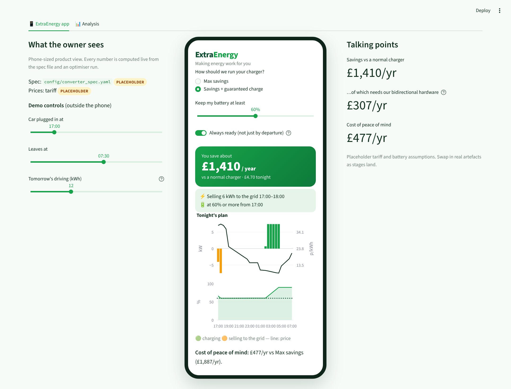
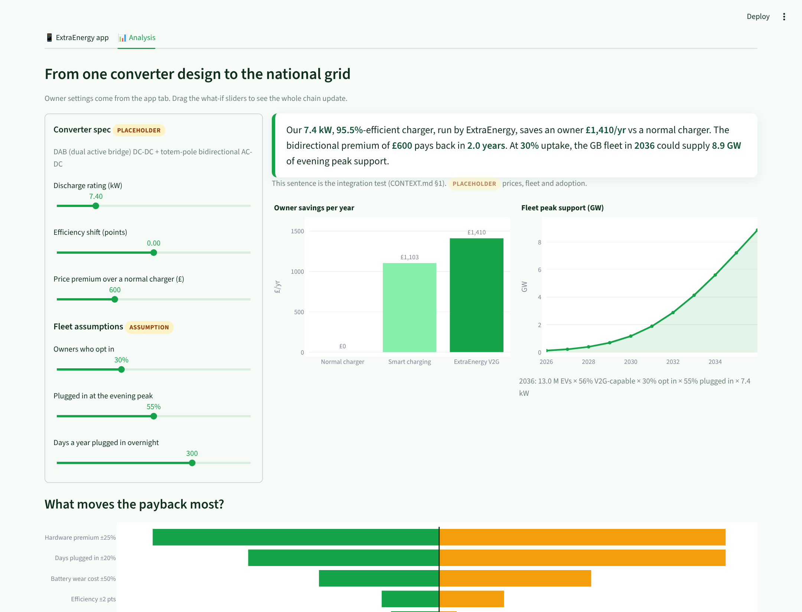

# ExtraEnergy — *Making energy work for you*

**Accelerating the EV transition.**

We sell a complete V2G product: a bidirectional EV charger (hardware) plus the software that
runs it, which learns from each driver's usage and forecasts energy prices to decide when the
car should charge and when it should sell back. The owner chooses how the software behaves:
**maximum savings**, or the best savings while **guaranteeing the car is charged** to a level
they pick whenever they need it. We show, with data, what that product is worth to the owner,
and how much energy each car sells back to the grid when it is needed most.

Target market: any EV owner with a home mains connection, supported by government subsidies.
*Coming soon: ExtraEnergy for fleets.*

**Live app:** https://extraenergy.streamlit.app/ (Streamlit Community Cloud; if it has been idle,
click "wake up" and give it a minute)

| Owner view | Analysis view |
|---|---|
|  |  |

## Run the app locally (macOS)

Needs Python 3.11 or 3.12 (the built-in macOS `python3` is too old). With
[uv](https://docs.astral.sh/uv/) (`brew install uv`):

```bash
uv venv --python 3.12 .venv
source .venv/bin/activate
uv pip install -r requirements.txt pytest pydantic
streamlit run dashboard/app.py        # opens http://localhost:8501 (Ctrl+C to stop)
```

Without uv: `python3.12 -m venv .venv`, then `pip install -r requirements.txt pytest pydantic`.

The app has three tabs: **ExtraEnergy app** (what the owner sees), **Analysis** (prices, the
habits model, savings, payback) and **Hardware** (the converter spec). Anything marked
PLACEHOLDER is synthetic until the matching pipeline stage lands.

## Run the data pipeline (price data and forecasts)

The full pipeline needs more packages than the app (`pyproject.toml`):

```bash
uv pip install -e ".[dev]"
make data-prices      # GB wholesale prices (Elexon MID) -> data/processed/prices.parquet
make forecast-naive   # naive price baselines + eval -> artefacts/forecasts/price_quantiles.parquet
```

Data ingest lives in `src/v2g/ingest/` and price forecasts in `src/v2g/forecast/` (see their
READMEs). Raw API responses are cached under `data/raw/` and cleaned tables written to
`data/processed/`; both are gitignored. Settings live under `forecast:` and `ingest:` in
`config/assumptions.yaml`. See the `Makefile` for every stage.

## Run the tests

```bash
source .venv/bin/activate
pytest tests/
```

## Where things are

- `CONTEXT.md`: the full plan (pitch, interfaces, units, pipeline, checks). Start here.
- `dashboard/app.py`: the Streamlit app. Theme colours: `.streamlit/config.toml`.
- `config/converter_spec.yaml`: the hardware spec (owned by the hardware team).
- `8b_singleev_optimiser/v2g-hack/`: the single-vehicle optimiser and the habits model
  (trained on Electric Nation data); see its `docs/optimisation_problem.md`.

## License

MIT
