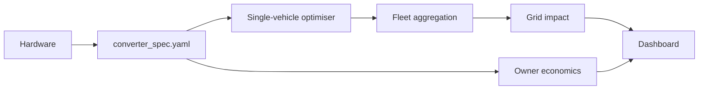

# V2G Hackathon — Project Context File

> Purpose: a single source of truth for the project, designed to give an LLM or team a concrete structure for the repo, pipeline stubs, interfaces and work split.

## 0. How to use this file

1. Generate the repo tree in section 10.
2. Every stage reads and writes only the artefacts named in section 9.
3. Implement the shared interface schema in section 6 first.
4. All physical quantities use the units in section 6.3.
5. Every stage must run end-to-end on default placeholder inputs from hour 0.
6. Generate tests for the consistency checks in section 12.

## 1. One-line pitch and core thesis

**Pitch:** We design a bidirectional EV charger and show what that exact design is worth to the owner who buys it and to the grid it plugs into, today and in 10 years.

The logical chain is:

Hardware design → converter spec → single vehicle optimizer → fleet aggregation → grid impact → decade forecast → design feedback loop.

## 2. Team, strengths and ownership

| Person | Strengths | Primary track | Natural bridge role |
|---|---|---|---|
| Abdullah | Electrical hardware, device-level design, C++ | Hardware | Converter efficiency model |
| Issa | Electrical hardware, C | Hardware | Embedded control and loss model |
| Tony | Python, ML, optimisation | Data/ML | Optimisation and forecasting |
| Me | Python, modelling, ML | Data/ML + integration | Schema, pipeline glue, adoption and grid analysis |

## 3. Assumptions and open questions

- Hackathon duration assumed 24–36 hours.
- Region should be parameterised in `config/assumptions.yaml`.
- Default architecture: DC off-board wallbox.
- Primary use case: home single-phase charger.
- Hardware is assumed to be low-voltage only for safety.

## 4. Landscape snapshot

- Commercial V2G is arriving in 2026.
- Regulation and tariff design materially affect economics.
- EVs are likely to become a major flexibility resource.
- Standards include ISO 15118-20, IEC 61851 and grid codes by region.

## 5. System architecture



## 6. Interface contract

### 6.1 `config/converter_spec.yaml`

```yaml
spec_version: "0.1"
provenance: placeholder
topology: "DAB (dual active bridge) DC-DC + totem-pole bidirectional AC-DC"
architecture: dc_offboard
grid_side:
  phases: 1
  v_ac_rms: 230
  f_hz: 50
battery_side:
  v_dc_min: 250
  v_dc_max: 450
power:
  p_charge_max_kw: 7.4
  p_discharge_max_kw: 7.4
  q_max_kvar: 3.0
efficiency_curve:
  load_fraction: [0.05, 0.10, 0.25, 0.50, 0.75, 1.00]
  eta_charge: [0.80, 0.88, 0.94, 0.96, 0.96, 0.955]
  eta_discharge: [0.78, 0.87, 0.93, 0.955, 0.955, 0.95]
standby_w: 10
dynamics:
  response_time_s: 1.0
  ramp_kw_per_s: 5.0
cost:
  bom_cost: 900
  install_cost: 500
  unidirectional_baseline_cost: 800
lifetime_years: 10
uncertainty:
  eta_abs: 0.01
  cost_rel: 0.25
```

### 6.4 `config/design_targets.yaml`

```yaml
value_optimal_p_rated_kw: null
marginal_value_per_eta_point: null
max_cost_for_5yr_payback: null
min_response_time_for_freq_services_s: null
```

## 7. Hardware track

Hardware should deliver a trade-off table and a loss model. Priority outputs:

- topology trade-off table
- efficiency curve and standby loss
- costed BOM
- dynamic response estimate
- low-voltage demonstration plan

## 8. Data / ML / optimisation track

### 8.A Price forecasting

Use price forecasting with a simple benchmark first, then move to LightGBM or deep time-series if time allows.

### 8.B Single-vehicle schedule optimiser

Formulate as a deterministic LP / MPC problem with a SoC battery balance and departure constraints.

### 8.C Battery degradation

Model degradation as a cost term so the optimizer balances revenue against battery wear.

### 8.D Fleet aggregation

Take single-vehicle schedules and aggregate to fleet flexibility by hour and scenario.

### 8.E EV adoption forecast

Estimate EV stock and V2G participation over a 10-year horizon.

### 8.F Grid impact and reliability

Measure peak reduction, renewable absorption and adequacy proxies.

### 8.G Owner economics

Compute annual revenue, payback and NPV in the project dashboard.

## 9. Pipeline stages

| Stage | Inputs | Outputs |
|---|---|---|
| S0 | config/schema | shared assumptions and spec |
| S1 | hardware outputs | updated converter spec |
| S2 | raw price/generation data | cleaned processed data |
| S3 | prices/features | price forecasts |
| S4 | battery params | degradation cost model |
| S5 | spec + forecasts + availability | vehicle schedules |
| S6 | EV registrations | adoption forecast |
| S7 | vehicle schedules + adoption | fleet flexibility |
| S8 | fleet + demand + generation | grid metrics |
| S9 | spec + schedules | economics |
| S10 | sweep over design parameters | design targets |
| S11 | all outputs | dashboard and headline result |

## 10. Repo skeleton

```text
v2g-hack/
├── README.md
├── v2g_hackathon_context.md
├── Makefile
├── pyproject.toml
├── config/
│   ├── assumptions.yaml
│   ├── converter_spec.yaml
│   └── design_targets.yaml
├── shared/
│   ├── __init__.py
│   ├── schema.py
│   └── units.py
├── src/
│   └── v2g/
│       ├── __init__.py
│       ├── cli.py
│       ├── ingest/
│       ├── forecast/
│       ├── degradation/
│       ├── optimise/
│       ├── fleet/
│       ├── adoption/
│       ├── grid/
│       ├── economics/
│       └── sensitivity/
├── dashboard/
│   └── app.py
├── hardware/
│   ├── docs/
│   ├── bom/
│   ├── calc/
│   └── sim/
├── data/
│   ├── raw/
│   └── processed/
├── artefacts/
├── tests/
└── notebooks/
```

## 11. Data sources and risks

- Use public or cached data where possible.
- Prefer synthetic or placeholder data during initial smoke tests.
- Fallback to safe assumptions if a source is unavailable.

## 12. Consistency checks

- Validate YAML schema.
- Check energy balance.
- Check SoC bounds and departure constraints.
- Ensure converter performance is physically consistent.
- Ensure no simultaneous charge and discharge.

## 13. Milestones

- H0–H2: freeze schema and repo structure
- H2–H4: smoke test the pipeline with placeholders
- H4–H12: detailed forecasting, optimisation and hardware analysis
- H12–H20: full grid, fleet and economic output
- final hours: dashboard, pitch and demo polish

## 14. Deliverables menu

- hardware trade-off table
- loss breakdown and efficiency curve
- C++ / Python efficiency model
- battery schedule optimiser
- fleet flexibility dashboard
- payback and grid-value analysis
- final narrative with a clear headline result

## 15. Reading list

Key references include V2G papers on fundamentals, optimisation, forecasting and degradation. See the project notes for the full list.

## 16. Risks and mitigations

- Overly complex forecasting: start simple and use decision value as the metric.
- Hidden coupling: keep the interface contract strict.
- Safety: keep all physical builds low-voltage only.
- Integration slip: freeze the schema early and smoke test often.
